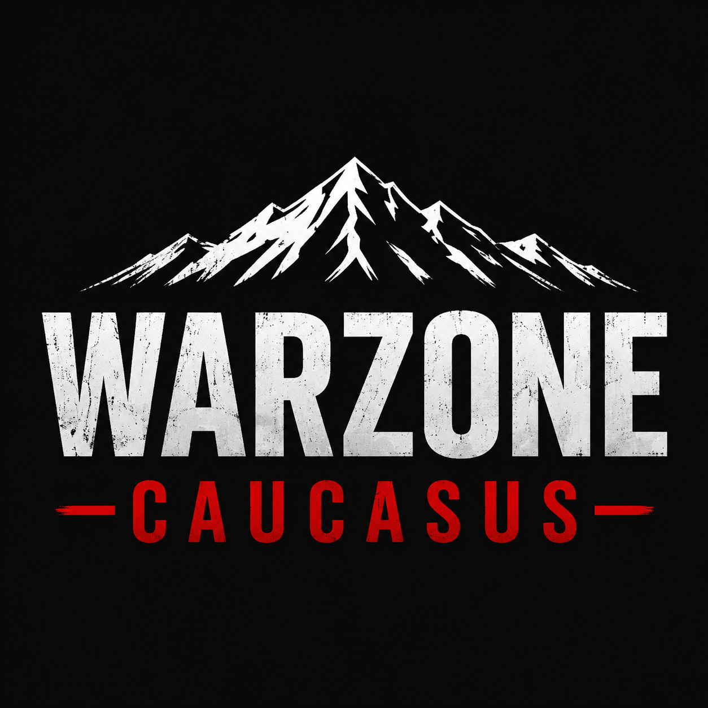

# WarZone Caucasus – Dynamic Sector Campaign

**Latest mission release: [v4.51](https://github.com/Iron87ita/WarZone-Caucasus-Dynamic-Sector-Campaign/releases/tag/v4.51) (2026-11-18) · DCS World · Caucasus · Dynamic PvE / PvPvE**



WarZone Caucasus is a persistent single-player and multiplayer campaign by **IRON87ITA**, built around progressive sector warfare. The operational front expands as sectors are captured, creating a focused battlefield while avoiding unnecessary AI activity across the entire map.

## What’s new in v4.51

- Two-aircraft reactive CAP responds to player and AI tasking and detected attacks from the nearest eligible friendly airfield.
- Revised BARCAP airspace, NATO carrier placement, RF air tasking templates and support tracks. A hot-start BLUE Su-27 client slot is available at Sukhumi.
- F10 commands are grouped by flight and coalition. Eligible kills and completed player tasks include 10 additional personal credits.
- The 25-page kneeboard is free of version labels. The general, NATO and RF briefings describe the current mission.

See the [v4.51 release notes](docs/releases/v4.51.md) for the aircraft changes, payouts and download checksum.

## Highlights

- Fourteen strategic sectors
- Independent NATO and RED campaign paths
- Persistent campaign progression
- Dynamic sector activation
- Player-scaled enemy air forces
- CAP, BARCAP, CAS, SEAD and strike missions
- Enhanced adaptive AI activity with coalition-specific F10 tempo controls
- Friendly AI escorts and opposing AI intercept/attack tasks
- Direct SEAD attacks with mixed weapons and bounded retries
- Explicit bingo-fuel return to the nearest friendly runway
- Moving ground columns with continued advances and bounded route recovery
- Dynamic AI commander and F10 commander menu
- Player shop and support-purchasing system
- Persistent purchased ground units and MQ-9/JTAC assets
- Friendly-zone and map-marker deployment
- Forward helicopter operations, FARPs and FOB support
- Tanker, AWACS, JTAC and GCI support
- Integrated briefing and kneeboard
- Single-player and multiplayer compatible

## Campaign structure

### NATO progression

```text
3 → 2 → 1 → 6 → 7 → 8 → 9 → 10
```

### RED progression

```text
3 → 4 → 5 → 11 → 12 → 13 → 14
```

Only the current front and previously unlocked sectors remain active. The campaign covers the Northern Caucasus, Mozdok, Krasnodar, the Black Sea coast, Georgia and Abkhazia.

## Dynamic operations

Players can launch or support multiple mission types through the campaign systems:

- Combat Air Patrol and BARCAP
- Close Air Support
- Suppression of Enemy Air Defences
- Strike missions
- Dynamic counterattacks
- Ground-force purchases and deployment
- MQ-9 / JTAC support
- Tanker and AWACS operations

Enemy air and ground dispatcher activity scale with the total number of active players. In AUTO, the dispatcher allows up to 3 combat flights and 2 columns per coalition for solo/duo play, increasing to 8 combat flights and 4 columns at 7+ players. Up to 1 AWACS and 2 tankers are available in addition. Zone defenses retain their intended operational strength.

Open **F10 Other → 01 WarZone | Flight → 01 Missions** for sector missions, friendly AI escorts, enemy AI intercepts, the current task, cancellation and the AI task guide. Check reactive CAP status under **02 WarZone | Coalition → 02 Intelligence**. The coalition tempo and column controls are under **Missions → Friendly AI → Operations**.

Choose **Friendly AI** to protect a live friendly flight, or **Enemy AI** to intercept/attack an opposing group. Standard escort requires five minutes airborne within 5 NM; cargo escort requires confirmed delivery and at least 60 seconds nearby. Assigned-group tracks and catalogs update every 30 seconds. Personal bonuses require safe RTB.

Combat AI receives role tasking after takeoff. Regular CAP covers its assigned friendly sector, BARCAP patrols the Central Air Corridor, and reactive CAP investigates an alert. Combat flights return at 30% internal fuel or earlier if measured burn requires more reserve. A flight whose recovery runway changes hands can divert to another friendly airfield.

See the [English AI control and task guide](docs/AI_CONTROL_AND_TASKS.md).

## Persistence

Campaign progress is saved between mission and server restarts. Version 4.47 adds a dedicated persistence layer for assets purchased through the player shop.

Purchased units now retain:

- Surviving members of partially damaged groups
- Saved position and heading
- Coalition and country information
- MQ-9 / JTAC deployment state
- Permanent removal after destruction

Shop units remain separate from the standard ZoneCommander respawn tables, preserving zone defence, capture, counterattack and garrison behaviour.

Version 4.51 retains the campaign persistence filename and save schema. No save migration is introduced; back up an existing save before upgrading. AI tempo selections and live AI task assignments apply to the current mission session.

## Release and source-code status

The current downloadable mission is [v4.51](https://github.com/Iron87ita/WarZone-Caucasus-Dynamic-Sector-Campaign/releases/tag/v4.51). See the [changelog](CHANGELOG.md) for earlier releases.

The `main` branch also contains [Web Command Center source code](web/README.md) and Lua integrations for telemetry and web-based mission acceptance. These remain **separate source integrations and are not embedded in the v4.51 `.miz`**.

The release notes list the archive, kneeboard, briefing and simulated Lua checks performed on the published package. In-simulator flight testing is pending.

Historical packaging note: the older v4.45 release includes a `V4_55.miz` filename whose published SHA-256 matches the v4.45 asset. That filename does not establish a newer build.

## Installation and update

1. Download `WarZone_IRON87_CAUCASO_DYNAMIC_SECTOR_MODERN_V4_51.miz` from the [latest GitHub release](https://github.com/Iron87ita/WarZone-Caucasus-Dynamic-Sector-Campaign/releases/latest).
2. Stop the current WarZone mission or dedicated server.
3. Replace the previous mission with the new `.miz` file.
4. Back up and keep the existing compatible persistence file.
5. Start the mission and continue the campaign.

No campaign reset is required when upgrading from a compatible version.

## Community

- YouTube: [@Iron87Ita](https://www.youtube.com/@Iron87Ita)
- Discord: `iron87`

Feedback and campaign reports are welcome through [GitHub Issues](https://github.com/Iron87ita/WarZone-Caucasus-Dynamic-Sector-Campaign/issues).

## Disclaimer

This is an unofficial community mission for DCS World. DCS and related product names are trademarks of Eagle Dynamics SA. This project is not affiliated with or endorsed by Eagle Dynamics.


